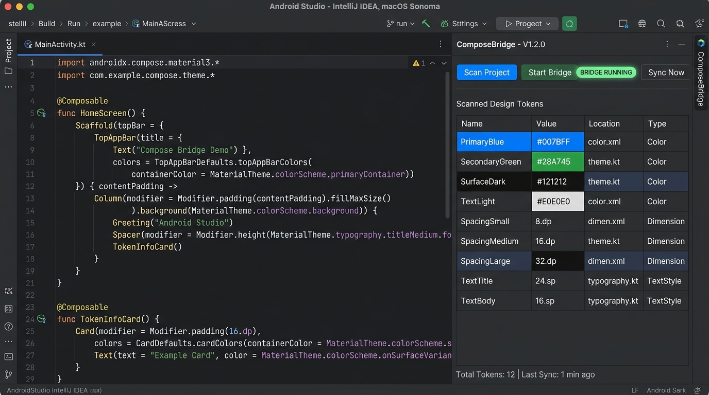
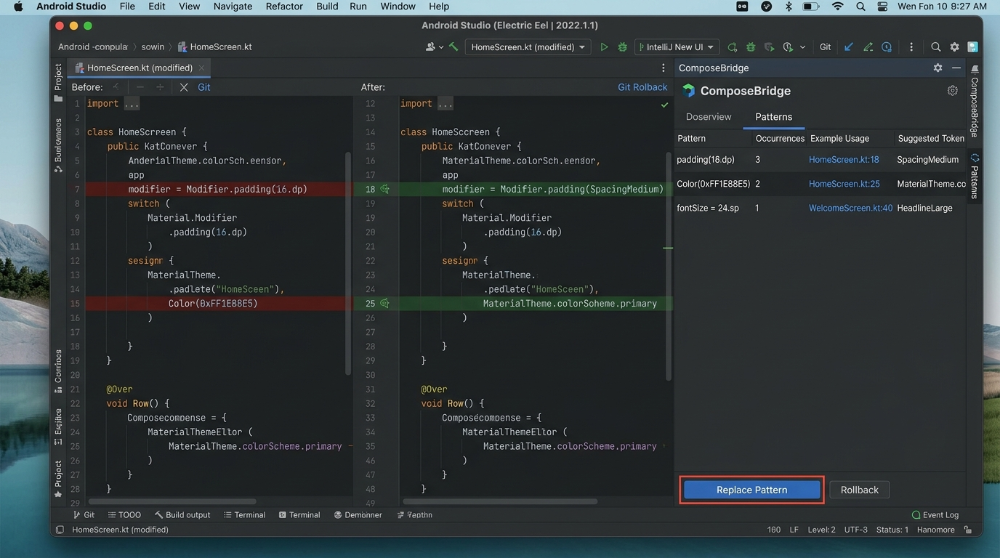
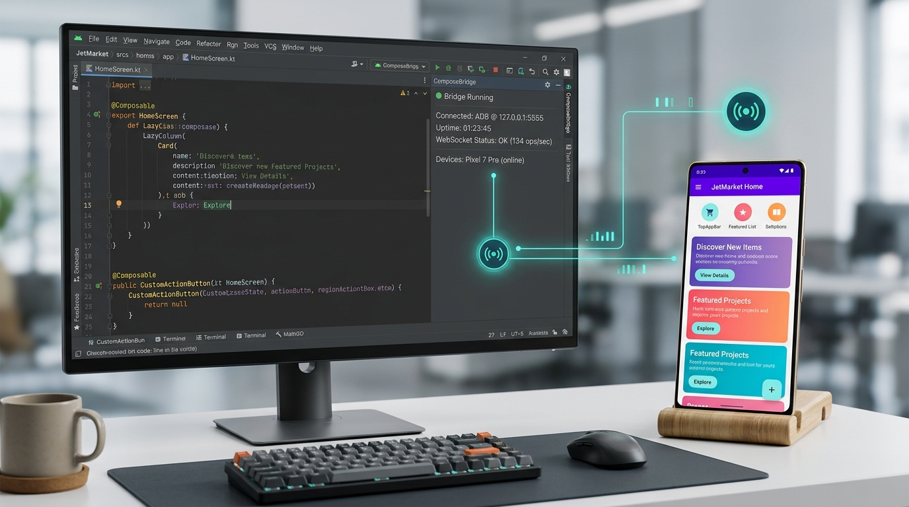

# ComposeBridge 🌉

**Real-time on-device visual editor for Jetpack Compose + Model Context Protocol (MCP) server for AI coding agents.**  
*Live UI tuning (<50ms latency), AST-guided surgical source code splicing, and autonomous AI-assisted refactoring.*

[](https://kotlinlang.org)
[](https://developer.android.com/jetpack/compose)
[]()
[]()
[]()
[]()
[](https://github.com/JALAL591/compose-bridge/blob/main/LICENSE)
[](https://glama.ai/mcp/servers/JALAL591/compose-bridge)

## 📰 Featured In

<p align="left">
  <a href="https://androidweekly.net/issues/issue-746" title="Android Weekly Issue #746">
    
  </a>
</p>

[English](README.md) | [العربية](README_AR.md)

---

### 📥 Direct Downloads (v1.1.2)

| Package | Asset | Purpose |
|---|---|---|
| **IDE Plugin (Android Studio / IntelliJ)** | [📥 **ComposeBridgeIntelliJ-1.1.2.zip**](dist/ComposeBridgeIntelliJ-1.1.2.zip) | Install in IDE: `Settings` ➔ `Plugins` ➔ `⚙️` ➔ `Install Plugin from Disk...` |
| **Compose Runtime Library (Release & Debug)** | [📦 **composebridge-runtime-release.aar**](dist/composebridge-runtime-release.aar) | Core registries (~9KB). Required in `implementation` for production-safe APK builds |
| **Compose Agent Library (Debug Only)** | [📦 **composebridge-agent-release.aar**](dist/composebridge-agent-release.aar) | Visual overlays, touch inspector, and WebSocket bridge. Put in `debugImplementation` |
| **Python Server & MCP Package** | [📦 **composebridge-server-1.1.2.zip**](dist/composebridge-server-1.1.2.zip) | Modular WebSocket hub & MCP server for AI agents |
| **All-in-One Distribution** | [📦 **ComposeBridge-v1.1.2-AllInOne.zip**](dist/ComposeBridge-v1.1.2-AllInOne.zip) | Bundles Plugin, Runtime, Agent, and Server together |

---

## 📸 Visual Demo

Watch ComposeBridge visually edit a running Jetpack Compose UI live:

<p align="center">
  <a href="https://www.youtube.com/watch?v=Hywyq7cBdDM">
    
  </a>
</p>

### Screenshots

| 1. Studio ToolWindow & Token Scanner | 2. Surgical Pattern Refactoring & Diff | 3. Live On-Device Preview & Inspector |
|:---:|:---:|:---:|
| [](docs/screenshots/1_composebridge_main_ui.jpg) | [](docs/screenshots/2_composebridge_patterns_diff.jpg) | [](docs/screenshots/3_composebridge_live_device_sync.jpg) |

---

## ⚡ Quick Start in 60 Seconds

### Step 1: Install IDE Plugin
1. Download [ComposeBridgeIntelliJ-1.1.2.zip](dist/ComposeBridgeIntelliJ-1.1.2.zip).
2. In Android Studio, go to **Settings (Preferences)** ➔ **Plugins** ➔ Click the **⚙️ gear icon** ➔ **Install Plugin from Disk...**.
3. Select the zip file and restart Android Studio.

### Step 2: Add Dependencies to your Android App
Copy `composebridge-runtime-release.aar` and `composebridge-agent-release.aar` into your app module's `libs/` folder:
```kotlin
// app/build.gradle.kts
dependencies {
    // 1. Runtime registries: compiles cleanly in both Debug & Release
    implementation(files("libs/composebridge-runtime-release.aar"))

    // 2. Interactive visual inspector: debug builds only
    debugImplementation(files("libs/composebridge-agent-release.aar"))
}
```

### Step 3: Initialize in MainActivity (Debug)
```kotlin
// MainActivity.kt
import com.composebridge.agent.ComposeBridgeAgent

class MainActivity : ComponentActivity() {
    override fun onCreate(savedInstanceState: Bundle?) {
        super.onCreate(savedInstanceState)
        
        // Start bridge connection (automatically connects to local hub)
        ComposeBridgeAgent.start(serverUrl = "ws://127.0.0.1:8711")

        setContent {
            // Wrap root content in ComposeBridgeAgent.Root
            ComposeBridgeAgent.Root {
                MyApplicationTheme {
                    MainScreen()
                }
            }
        }
    }
}
```

### Step 4: Start the Bridge & Tune Live
1. In Android Studio, open the **ComposeBridge** tool window on the right sidebar and click **▶ Start Bridge** (this starts the local server and runs `adb reverse tcp:8711 tcp:8711` automatically).
2. Run your app on your device or emulator.
3. Tap the floating **🔧 FAB** on screen to toggle Design Mode.
4. Tap any text, color, or dimension to adjust values in real-time!

---

## 📐 Architecture & Communication Flow

ComposeBridge coordinates three interconnected components over a fast local loopback interface:

```text
 +--------------------------+                 +----------------------------+
 |   Android Phone / AVD    |                 |   Local WebSocket Hub      |
 |                          |                 |   (Python 3.10+ Daemon)    |
 |  [App UI in Compose]     |                 |                            |
 |            |             |   WebSocket     |   server.py (:8711)        |
 |  [:composebridge-agent]  |<===============>|      ├── Message Router    |
 |    - Visual Touch Overlay|   (Port 8711)   |      ├── AST Splicer       |
 |    - Semantic Inspector  |                 |      └── PatternJournal    |
 |            |             |                 +----------------------------+
 |  [:composebridge-runtime]|                               ||
 |    - TextRegistry        |                               || JSON-RPC
 |    - ThemeRegistry       |                               || (stdio / TCP)
 |    - DimensionRegistry   |                               \/
 +--------------------------+                 +----------------------------+
                                              |   Developer Tools & AI     |
                                              |                            |
                                              |  [Android Studio Plugin]   |
                                              |    - Live Changes Diff     |
                                              |    - Token Split / Scanner |
                                              |  [Autonomous MCP Agents]   |
                                              |    - Antigravity / Claude  |
                                              |    - 27 Standard MCP Tools |
                                              +----------------------------+
```

1. **On-Device Agent (`:composebridge-agent`):** Injected via `ComposeBridgeAgent.Root`. Renders non-intrusive hit-testing overlays, extracts semantic metadata, and transmits change requests over local WebSocket (`ws://127.0.0.1:8711`).
2. **Decoupled Runtime (`:composebridge-runtime`):** Standalone ~9KB runtime containing registry singletons (`BridgeTextRegistry`, `BridgeThemeRegistry`, `BridgeDimensionRegistry`). Ensures production Release builds compile with zero overhead without packaging debug overlays.
3. **Local Bridge Server (`server.py`):** Acts as the central event hub and Kotlin AST manipulation engine. Applies deterministic changes using file write-locks, atomic rewrites, and maintains a byte-level `.bridge.bak` rollback journal.
4. **Model Context Protocol (MCP Server):** Exposes 27 structured tools allowing AI pair programmers (Antigravity, Claude, Cursor) to autonomously analyze token usage, suggest token splits, and execute multi-file refactorings.

---

## 🚀 Core Capabilities

| Capability | Description |
|---|---|
| **⚡ Instant Live Tuning** | Tweak colors, paddings, and string contents with **sub-50ms latency**. Changes update dynamically without waiting for Gradle rebuilds. |
| **🧠 Semantic Token Intelligence** | Detects whether a modified color or dimension is shared globally. Offers **Split** (create an isolated token for this widget) or **Global** (update theme-wide). |
| **📝 Text Editing & Auto-Migration** | Tap any text element to edit wording directly on device. The AST engine automatically wraps raw strings into `BridgeTextRegistry` on first edit. |
| **💾 Safe Rollbacks (PatternJournal)** | Every surgical edit is backed up byte-for-byte. The Studio **Changes** tab allows reviewing unified diffs and reverting individual files or all edits with one click. |
| **🤖 Full MCP Server for AI Agents** | 27 tools supporting token discovery, impact analysis, orphan detection, surgical pattern replacement, and safe Gradle compilation validation. |

---

## 🤖 MCP Server (AI Coding Assistants)

ComposeBridge exposes 27 deep-inspection and code refactoring tools to any AI assistant supporting the **Model Context Protocol (MCP)**. **No physical phone is required to use MCP tools.**

### Compatible AI Clients:
- ✅ **Google Antigravity IDE**
- ✅ **Claude Desktop**
- ✅ **Cursor**
- ✅ **Windsurf / Continue**

### Configuration (`mcp_config.json`):
```json
{
  "mcpServers": {
    "composebridge": {
      "command": "python",
      "args": ["-u", "C:\path\to\compose-bridge\server\mcp_server.py"],
      "env": {
        "PYTHONIOENCODING": "utf-8"
      }
    }
  }
}
```

### Overview of MCP Tools (27 Tools):
- **Token Discovery & Analysis:** `list_tokens`, `find_token_by_color`, `get_token_impact`, `get_token_siblings`, `get_all_token_groups`, `list_orphans`, `get_naming_convention`.
- **Surgical Code Editing:** `set_token`, `set_text`, `add_token`, `rollback_last`.
- **Pattern Refactoring:** `replace_pattern`, `list_applied_patterns`, `rollback_pattern`, `suggest_token_split`, `detect_conditional_variants`.
- **Change Management:** `list_modified_files`, `get_file_diff`, `approve_file_changes`, `reject_file_changes`, `approve_all_files`, `reject_all_files`, `reject_all_files_force`.
- **Build Verification:** `run_gradle_build`, `list_allowed_gradle_tasks`, `trigger_user_sync`, `get_sync_status`.

---

## ⚠️ Known Limitations

- **Platform Target:** Live on-device inspection currently supports **Android** (API 24+). Kotlin Multiplatform Desktop and iOS overlays are in active development.
- **Python Requirement:** The local bridge server requires **Python 3.10 or newer**.
- **USB Port Forwarding:** When testing on a physical device over USB, port forwarding is required (`adb reverse tcp:8711 tcp:8711`). The Studio plugin runs this automatically on startup.
- **Initial Rebuild on New Tokens:** When converting a hardcoded literal to an entirely new named token for the first time, one standard Gradle compile is required so the Kotlin compiler emits the new getter bytecode. Subsequent live tweaks to that token are instantaneous.

---

## 🔧 Troubleshooting & FAQ

### 1. The phone shows `[WS] Connection failed`
- Ensure the bridge server is running (`🟢 Bridge Running` in Studio or `python server.py` in terminal).
- If using USB, verify ADB reverse is active by running:
  ```bash
  adb reverse tcp:8711 tcp:8711
  ```
- If using Wi-Fi without USB, specify your workstation's LAN IP when calling `ComposeBridgeAgent.start(serverUrl = "ws://192.168.1.X:8711")`.

### 2. Build error: `Duplicate class found in modules`
- Make sure `composebridge-runtime-release.aar` is added under `implementation(...)` and `composebridge-agent-release.aar` is added under `debugImplementation(...)`. Do not include the agent in release configurations.

### 3. Edits do not show in Android Studio
- Ensure you have the project root properly set in `composebridge.json` or pass `--project <path>` when launching `server.py`.
- Check the **Changes** tab in the ComposeBridge tool window to review pending file diffs.

---

## 🤝 Contributing & Community

We welcome contributions! Please review our:
- **[Contributing Guidelines](CONTRIBUTING.md)**: Development setup, coding standards, and PR process.
- **[Security Policy](SECURITY.md)**: Supported versions and vulnerability disclosure guidelines.
- **[Architectural Vision (RFC-001)](docs/architecture/RFC-001-vision.md)**: Technical roadmap and core invariants.

---

## 📜 License

Distributed under the **[Apache License 2.0](LICENSE)**.
