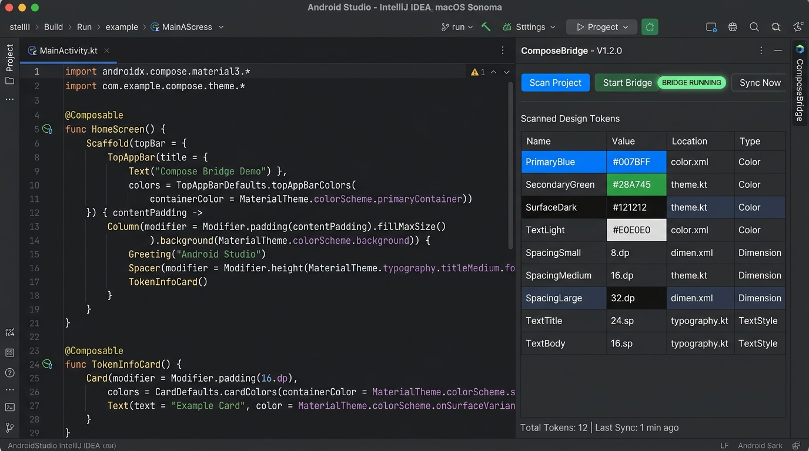
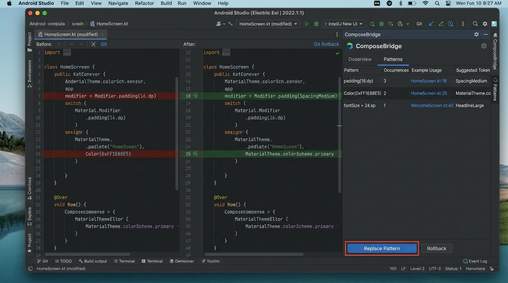
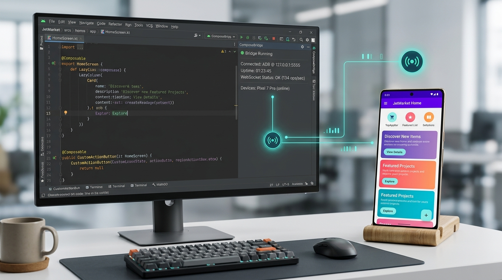

# ComposeBridge 🌉

**Real-time on-device visual editor for Jetpack Compose + Model Context Protocol (MCP) server for AI coding agents.**  
*Live UI tuning (<50ms latency), AST-guided surgical source code splicing, and autonomous AI-assisted refactoring.*

[](https://kotlinlang.org)
[](https://developer.android.com/jetpack/compose)
[]()
[]()
[]()
[]()
[](https://github.com/JALAL591/compose-bridge/blob/main/LICENSE)
[](https://plugins.jetbrains.com/plugin/35226-composebridge)
[](https://glama.ai/mcp/servers/JALAL591/compose-bridge)
[](https://m8ven.ai/mcp/jalal591-compose-bridge-rapm1x?s=readme)
[](https://devhunt.org/tool/compose-bridge)
[](https://mcpmarket.com/server/composebridge?utm_source=readme&utm_medium=badge)
## 📰 Featured In

<p align="left">
  <a href="https://androidweekly.net/issues/issue-746" title="Android Weekly Issue #746">
    
  </a>
  &nbsp;
  <a href="https://jetc.dev/issues/336.html" title="jetc.dev Newsletter Issue #336">
    
  </a>
</p>


[English](README.md) | [العربية](README_AR.md)

---

### 📥 Direct Downloads (v1.1.7)

| Package | Asset | Purpose |
|---|---|---|
| **IDE Plugin (Android Studio / IntelliJ)** | [🚀 **Install from JetBrains Marketplace**](https://plugins.jetbrains.com/plugin/35226-composebridge)<br>or [📥 **ComposeBridgeIntelliJ-1.1.7.zip**](https://github.com/JALAL591/compose-bridge/raw/main/dist/ComposeBridgeIntelliJ-1.1.7.zip) | Official Marketplace install (One-click) or manual install via `Settings` ➔ `Plugins` ➔ `⚙️` ➔ `Install Plugin from Disk...` |
| **Compose Runtime Library (Release & Debug)** | [📦 **composebridge-runtime-release.aar**](https://github.com/JALAL591/compose-bridge/raw/main/dist/composebridge-runtime-release.aar) | Core registries (~9KB). Required in `implementation` for production-safe APK builds |
| **Compose Agent Library (Debug Only)** | [📦 **composebridge-agent-release.aar**](https://github.com/JALAL591/compose-bridge/raw/main/dist/composebridge-agent-release.aar) | Visual overlays, touch inspector, and WebSocket bridge. Put in `debugImplementation` |
| **Python Server & MCP Package** | [📦 **composebridge-server-1.1.7.zip**](https://github.com/JALAL591/compose-bridge/raw/main/dist/composebridge-server-1.1.7.zip) | Standalone modular WebSocket hub & MCP server for AI coding agents |
| **All-in-One Distribution** | [📦 **ComposeBridge-v1.1.7-AllInOne.zip**](https://github.com/JALAL591/compose-bridge/raw/main/dist/ComposeBridge-v1.1.7-AllInOne.zip) | Complete offline distribution: Plugin, Runtime, Agent, Server, and Docs |

---

## 📸 Visual Demo

Watch ComposeBridge visually edit a running Jetpack Compose UI live:

<p align="center">
  <a href="https://www.youtube.com/watch?v=Hywyq7cBdDM">
    
  </a>
</p>

### Screenshots

| 1. Studio ToolWindow & Token Scanner | 2. Surgical Pattern Refactoring & Diff | 3. Live On-Device Preview & Inspector |
|:---:|:---:|:---:|
| [](docs/screenshots/1_composebridge_main_ui.jpg) | [](docs/screenshots/2_composebridge_patterns_diff.jpg) | [](docs/screenshots/3_composebridge_live_device_sync.jpg) |

---

## 🔄 Upgrading from v1.1.x to v1.1.7

Upgrading from ComposeBridge v1.1.x to v1.1.7 is straightforward and involves **zero breaking changes** in your codebase or Gradle configurations:

1. **Update the IDE Plugin:** Install the latest `dist/ComposeBridgeIntelliJ-1.1.7.zip` in Android Studio (**Settings** ➔ **Plugins** ➔ **Install Plugin from Disk...**) and restart the IDE.
2. **Update Android AAR:** Replace `composebridge-agent-release.aar` in your app module's `libs/` folder with the updated build from `dist/composebridge-agent-release.aar`, then re-sync Gradle.
3. **Update Python Server:** If running standalone, re-run `pip install -r requirements.txt --upgrade` in `server/`.
4. **Breaking Changes:** **None.** All protocol messages, runtime registries, and MCP tool signatures remain 100% backward-compatible.

---

## ⚡ Quick Start in 60 Seconds

### Step 1: Install IDE Plugin
1. Download [ComposeBridgeIntelliJ-1.1.7.zip](dist/ComposeBridgeIntelliJ-1.1.7.zip).
2. In Android Studio, go to **Settings (Preferences)** ➔ **Plugins** ➔ Click the **⚙️ gear icon** ➔ **Install Plugin from Disk...**.
3. Select the zip file and restart Android Studio.

### Step 2: Add Dependencies to your Android App
Copy `composebridge-runtime-release.aar` and `composebridge-agent-release.aar` into your app module's `libs/` folder:
```kotlin
// app/build.gradle.kts
dependencies {
    // 1. Runtime registries: compiles cleanly in both Debug & Release
    implementation(files("libs/composebridge-runtime-release.aar"))

    // 2. Interactive visual inspector: debug builds only
    debugImplementation(files("libs/composebridge-agent-release.aar"))
}
```

#### ⚠️ Kotlin Multiplatform (KMP) Projects
If your project targets both Android and Desktop (KMP) and you use ComposeBridge registries inside `commonMain`, **DO NOT use the `.aar` files** (as the desktop compiler cannot read Android `.aar` binaries). Instead, use the source modules as follows:

1. Copy the `agent/runtime` folder into your project (e.g. `composebridge-agent/runtime`).
2. In `settings.gradle.kts` (or `settings.gradle`), include the runtime module:
   ```kotlin
   include(":composebridge-runtime")
   project(":composebridge-runtime").projectDir = file("composebridge-agent/runtime")
   ```
3. In `composebridge-agent/build.gradle.kts`, expose runtime as an API dependency:
   ```kotlin
   kotlin {
       sourceSets {
           commonMain.dependencies {
               api(project(":composebridge-runtime"))
           }
       }
   }
   ```
4. In `composeApp/build.gradle.kts`, implement the agent module in `commonMain`:
   ```kotlin
   kotlin {
       sourceSets {
           commonMain.dependencies {
               implementation(project(":composebridge-agent"))
           }
       }
   }
   ```

### Step 3: Initialize in MainActivity (Debug)
```kotlin
// MainActivity.kt
import com.composebridge.agent.ComposeBridgeAgent

class MainActivity : ComponentActivity() {
    override fun onCreate(savedInstanceState: Bundle?) {
        super.onCreate(savedInstanceState)
        
        // Start bridge connection (automatically connects to local hub)
        ComposeBridgeAgent.start(context = this, serverUrl = "ws://127.0.0.1:8711")

        setContent {
            // Wrap root content in ComposeBridgeAgent.Root
            ComposeBridgeAgent.Root {
                MyApplicationTheme {
                    MainScreen()
                }
            }
        }
    }
}
```

### Step 4: Start the Bridge & Tune Live
1. In Android Studio, open the **ComposeBridge** tool window on the right sidebar and click **▶ Start Bridge** (this starts the local server and runs `adb reverse tcp:8711 tcp:8711` automatically).
2. Run your app on your device or emulator.
3. Tap the floating **🔧 FAB** on screen to toggle Design Mode.
4. Tap any text, color, or dimension to adjust values in real-time!

### 🌍 Remote Connection (Experimental)

Tune your running Compose UI over the internet (cellular data, separate Wi-Fi networks, or remote testing) without a physical USB cable using **Tailscale Funnel**:

#### Prerequisites
- Install [Tailscale](https://tailscale.com/download) on your PC and mobile device.
- Sign up for a Tailscale account (free for personal use).

#### Step-by-Step Setup:

##### Step 1: Configure Tailscale ACLs (Crucial!)
By default, Tailscale disables Funnel unless granted by your Access Control Lists (ACL). Before running the funnel command:
1. Open the [Tailscale Admin Console - Access Controls](https://login.tailscale.com/admin/acls).
2. In the JSON policy editor, add the following `nodeAttrs` block inside the root `{ ... }`:
   ```json
   "nodeAttrs": [
     {
       "target": ["*"],
       "attr": ["funnel"]
     }
   ]
   ```
3. Click **Save**.
> [!IMPORTANT]
> This step is required to grant your devices permission to expose Funnel ports. Skipping this step will cause `tailscale funnel 8711` to fail with: `funnel not allowed by ACLs`.

##### Step 2: Start Tailscale Funnel on your Computer
1. Launch Tailscale on your PC and sign in.
2. Open a Terminal or PowerShell prompt and run:
   ```bash
   tailscale funnel 8711
   ```
   *(Or: `tailscale serve https / http://127.0.0.1:8711`)*
3. **Leave this terminal open** (Tailscale Funnel must remain active).

##### Step 3: Get Connection Link in Android Studio / IntelliJ Plugin
1. Open the **ComposeBridge** tool window on the right sidebar.
2. Click the **"Share Remote"** button.
3. A dialog will open displaying a **QR Code** and your secure connection URL (`wss://...`).

##### Step 4: Connect on your Mobile Device
1. Launch your app (with ComposeBridge Agent enabled).
2. Tap the floating Design Mode button 🎨 -> **Connection Settings**.
3. Select **"Remote"**:
   - Tap **"Scan QR"** and scan the code directly from your computer screen, **OR**
   - Paste the URL via **"Paste from Clipboard"**.
4. Tap **"Connect Remote"** to establish the live bridge.

> [!WARNING]
> **Honest Notice:** Remote connections are **experimental**. The session may disconnect due to network changes (switching between Wi-Fi and mobile data), restrictive corporate firewalls, carrier NATs, or phone battery-saver/sleep modes. For maximum stability and guaranteed sub-50ms latency, a **physical USB connection** (`adb reverse tcp:8711 tcp:8711`) remains the gold standard. For technical boundaries, see [LIMITATIONS.md](LIMITATIONS.md).

---

## ⚙️ How It Works (Under the Hood)

ComposeBridge operates as a tri-part system coordinating an IDE extension, a surgical AST engine, and an on-device Compose observer:

- **Android Studio / IntelliJ Plugin:**
  Manages background Python server processes, displays real-time connection status, generates Tailscale WireGuard QR codes for remote WAN tunnels, and provides visual tabs (`Changes`, `Tokens`, `Orphans`, `Patterns`, `Status`) with unified diff review.
- **Python Server & Tree-sitter AST Engine:**
  Runs an asynchronous WebSocket hub on port `8711`. When an edit arrives, Tree-sitter parses the Kotlin syntax tree and performs **surgical code splicing** without disturbing un-targeted code, formatting, or comments. Employs atomic file locks (`_atomic_write_text`) with CRLF line-ending preservation.
- **Android Agent (`:composebridge-agent`):**
  Renders a zero-overhead hit-testing overlay via `ComposeBridgeAgent.Root`. Evaluates touch gestures, maps coordinates to semantic node bounds using `CompositionRegistry`, and applies overrides locally (<50ms) through `BridgeThemeRegistry`, `BridgeDimensionRegistry`, and `BridgeTextRegistry` so the UI responds instantaneously.
- **PatternJournal & Rollback Engine:**
  Before touching any source file, a pristine snapshot is verified with Tree-sitter and preserved as `.bridge.bak`. Rollbacks prioritize Git tracking (`git checkout -- <file>`), safely falling back to byte-level `.bridge.bak` restoration for untracked files.
- **Model Context Protocol (MCP Server):**
  Exposes 27 structured tools over stdio/JSON-RPC, enabling autonomous AI coding assistants (Antigravity, Cursor, Claude) to discover design tokens, detect orphans, suggest splits, and validate builds independently without requiring a physical phone connected.

---

## 📐 Architecture & Communication Flow

ComposeBridge coordinates three interconnected components over a fast local loopback interface:

```text
 +--------------------------+                 +----------------------------+
 |   Android Phone / AVD    |                 |   Local WebSocket Hub      |
 |                          |                 |   (Python 3.10+ Daemon)    |
 |  [App UI in Compose]     |                 |                            |
 |            |             |   WebSocket     |   server.py (:8711)        |
 |  [:composebridge-agent]  |<===============>|      ├── Message Router    |
 |    - Visual Touch Overlay|   (Port 8711)   |      ├── AST Splicer       |
 |    - Semantic Inspector  |                 |      └── PatternJournal    |
 |            |             |                 +----------------------------+
 |  [:composebridge-runtime]|                               ||
 |    - TextRegistry        |                               || JSON-RPC
 |    - ThemeRegistry       |                               || (stdio / TCP)
 |    - DimensionRegistry   |                               \/
 +--------------------------+                 +----------------------------+
                                              |   Developer Tools & AI     |
                                              |                            |
                                              |  [Android Studio Plugin]   |
                                              |    - Live Changes Diff     |
                                              |    - Token Split / Scanner |
                                              |  [Autonomous MCP Agents]   |
                                              |    - Antigravity / Claude  |
                                              |    - 27 Standard MCP Tools |
                                              +----------------------------+
```

1. **On-Device Agent (`:composebridge-agent`):** Injected via `ComposeBridgeAgent.Root`. Renders non-intrusive hit-testing overlays, extracts semantic metadata, and transmits change requests over local WebSocket (`ws://127.0.0.1:8711`).
2. **Decoupled Runtime (`:composebridge-runtime`):** Standalone ~9KB runtime containing registry singletons (`BridgeTextRegistry`, `BridgeThemeRegistry`, `BridgeDimensionRegistry`). Ensures production Release builds compile with zero overhead without packaging debug overlays.
3. **Local Bridge Server (`server.py`):** Acts as the central event hub and Kotlin AST manipulation engine. Applies deterministic changes using file write-locks, atomic rewrites, and maintains a byte-level `.bridge.bak` rollback journal.
4. **Model Context Protocol (MCP Server):** Exposes 27 structured tools allowing AI pair programmers (Antigravity, Claude, Cursor) to autonomously analyze token usage, suggest token splits, and execute multi-file refactorings.

---

## 🚀 Core Capabilities

| Capability | Description |
|---|---|
| **⚡ Instant Live Tuning** | Tweak colors, paddings, and string contents with **sub-50ms latency**. Changes update dynamically without waiting for Gradle rebuilds. |
| **🧠 Semantic Token Intelligence** | Detects whether a modified color or dimension is shared globally. Offers **Split** (create an isolated token for this widget) or **Global** (update theme-wide). |
| **📝 Text Editing & Auto-Migration** | Tap any text element to edit wording directly on device. The AST engine automatically wraps raw strings into `BridgeTextRegistry` on first edit. |
| **💾 Safe Rollbacks (PatternJournal)** | Every surgical edit is backed up byte-for-byte. The Studio **Changes** tab allows reviewing unified diffs and reverting individual files or all edits with one click. |
| **🤖 Full MCP Server for AI Agents** | 27 tools supporting token discovery, impact analysis, orphan detection, surgical pattern replacement, and safe Gradle compilation validation. |

---

## 🤖 AI Agent Integration (MCP)

ComposeBridge exposes 27 deep-inspection and code refactoring tools to any AI assistant supporting the **Model Context Protocol (MCP)**. **No physical phone is required to use MCP tools.**

> 💡 **Ultra-Lightweight Context Window:**
> ComposeBridge uses Lazy Loading, so 27 MCP tools consume only ~176 tokens (<1% of context window).

### Compatible AI Clients:
- ✅ **Google Antigravity IDE**
- ✅ **Cursor**
- ✅ **Claude Desktop**
- ✅ **Windsurf / Continue**

### Integration Steps:

#### Step 1: Run the MCP Server
Make sure server dependencies are installed and the server is executable from your `server` directory:
```bash
cd server
pip install -r requirements.txt
```

#### Step 2: Configure `mcp_config.json`
Add the ComposeBridge server configuration to your AI agent's config file (e.g. in `~/.gemini/config/mcp_config.json` or your IDE configuration):

```json
{
  "mcpServers": {
    "composebridge": {
      "command": "python",
      "args": ["-u", "C:\Users\thinkpad\StudioProjects\compose-bridge\server\mcp_server.py"],
      "env": {
        "COMPOSEBRIDGE_ROOT": "/absolute/path/to/your/android/project",
        "PYTHONIOENCODING": "utf-8"
      }
    }
  }
}
```

> ⚠️ **Important:** Any changes made to `mcp_config.json` require starting a **New Chat** in your AI agent interface so that all 27 MCP tools are freshly discovered and initialized.

#### How to set it up in Android Studio / Antigravity:
1. Open Android Studio / IntelliJ IDEA.
2. Go to **Settings** (or Preferences on macOS) → **Tools** → **AI** → **MCP Servers**.
3. Click on the **Installed** tab.
4. Click on the **"Import JSON file"** button (or **"...Add via JSON"** depending on your IDE version).
5. Paste the JSON configuration provided above.
6. Click **OK** or **Apply**.
7. ⚠️ **Crucial:** Start a **New Chat** (or restart the agent) for the new 27 MCP tools to load and become visible.

### Overview of MCP Tools (27 Tools):
- **Token Discovery & Analysis:** `list_tokens`, `find_token_by_color`, `get_token_impact`, `get_token_siblings`, `get_all_token_groups`, `list_orphans`, `get_naming_convention`.
- **Surgical Code Editing:** `set_token`, `set_text`, `add_token`, `rollback_last`.
- **Pattern Refactoring:** `replace_pattern`, `list_applied_patterns`, `rollback_pattern`, `suggest_token_split`, `detect_conditional_variants`.
- **Change Management:** `list_modified_files`, `get_file_diff`, `approve_file_changes`, `reject_file_changes`, `approve_all_files`, `reject_all_files`, `reject_all_files_force`.
- **Build Verification & Sync:** `run_gradle_build`, `list_allowed_gradle_tasks`, `trigger_user_sync`, `get_sync_status`.

---

## ⚠️ Honest Limitations & Operational Boundaries

> 📖 **Full Technical Disclosure:** For an exhaustive, unvarnished disclosure of operational edge cases and architectural constraints, see **[LIMITATIONS.md](LIMITATIONS.md)**.
> 
> ⚠️ **Key Notice:** **Remote Connection is experimental.** The tool will **safely pause** (`NEEDS_MANUAL_MAPPING`) and refuse to modify code if it cannot find design files (Colors, Dimensions, Strings) until you map them in the **Discovery** tab, protecting your project from accidental code pollution.

- **Remote Tunnel Stability:** Remote access via Tailscale is experimental. Mobile cellular handoffs or network firewalls can interrupt socket connectivity. USB tethering (`127.0.0.1`) remains recommended for mission-critical zero-latency editing.
- **Design System Mapping Required:** If the tool cannot locate your design system files automatically, it safely stops and asks for configuration in the Discovery tab rather than writing to arbitrary files.
- **Live Preview Connection:** Edits applied when the device is disconnected are saved safely to disk, but the mobile screen requires an active connection to recompose.
- **AI Agent Review:** Always review AI refactorings in the IDE **Changes** tab before approving.
- **Concurrent External Edits:** Editing the same line in your IDE while an unapproved bridge edit is pending will trigger an external conflict warning dialog.
- **Rate Limiting:** High-frequency continuous slider movements are rate-limited (100 msgs/10s) to prevent thread congestion over slow Wi-Fi.

### General Platform Constraints

- **Platform Target:** Live on-device inspection currently supports **Android** (API 24+). Kotlin Multiplatform Desktop and iOS overlays are in active development.
- **Python Requirement:** The local bridge server requires **Python 3.10 or newer**.
- **USB Port Forwarding:** When testing on a physical device over USB, port forwarding is required (`adb reverse tcp:8711 tcp:8711`). The Studio plugin runs this automatically on startup.
- **Initial Rebuild on New Tokens:** When converting a hardcoded literal to an entirely new named token for the first time, one standard Gradle compile is required so the Kotlin compiler emits the new getter bytecode. Subsequent live tweaks to that token are instantaneous.

---

## 🔧 Troubleshooting & FAQ

### 1. The phone shows `[WS] Connection failed`
- Ensure the bridge server is running (`🟢 Bridge Running` in Studio or `python server.py` in terminal).
- If using USB, verify ADB reverse is active by running:
  ```bash
  adb reverse tcp:8711 tcp:8711
  ```
- If using Wi-Fi without USB, specify your workstation's LAN IP when calling `ComposeBridgeAgent.start(serverUrl = "ws://192.168.1.X:8711")`.

### 2. Build error: `Duplicate class found in modules`
- Make sure `composebridge-runtime-release.aar` is added under `implementation(...)` and `composebridge-agent-release.aar` is added under `debugImplementation(...)`. Do not include the agent in release configurations.

### 3. Edits do not show in Android Studio
- Ensure you have the project root properly set in `composebridge.json` or pass `--project <path>` when launching `server.py`.
- Check the **Changes** tab in the ComposeBridge tool window to review pending file diffs.

---

## 🤝 Contributing & Community

We welcome contributions! Please review our:
- **[Contributing Guidelines](CONTRIBUTING.md)**: Development setup, coding standards, and PR process.
- **[Security Policy](SECURITY.md)**: Supported versions and vulnerability disclosure guidelines.
- **[Architectural Vision (RFC-001)](docs/architecture/RFC-001-vision.md)**: Technical roadmap and core invariants.

---

## 📜 License

Distributed under the **[Apache License 2.0](LICENSE)**.

---

## 🌍 Remote Access via Tailscale (WireGuard Secure Tunnel)

ComposeBridge v1.1.6 introduces zero-configuration remote access using **Tailscale Funnel**. You can now inspect, tweak, and live-preview Compose UI on physical Android devices over cellular data or remote Wi-Fi networks securely.

### 1. Prerequisites
- Install **Tailscale** on your workstation: [https://tailscale.com/download](https://tailscale.com/download)
- Log in and enable Tailscale: `tailscale up`
- Ensure [Tailscale Funnel](https://tailscale.com/kb/1223/funnel) is enabled for your tailnet node.

### 2. Share Remote from Android Studio
1. Open the **ComposeBridge** tool window in Android Studio.
2. Click **▶ Start Bridge** to launch the local WebSocket hub with dynamic 64-character token authentication.
3. Click **🌍 Share Remote** in the toolbar:
   - The plugin initiates `tailscale funnel 8711 --bg`.
   - A QR Code modal appears with your secure `wss://<node>.<tailnet>.ts.net` endpoint and session auth token.
4. (Optional) You can copy the URL or Token, or click **Stop Sharing** to turn off the funnel.

### 3. Connect from Android Device
1. Open your debug app with `ComposeBridgeAgent`.
2. Tap the floating **🎨** design button to open the toolbar, then tap the **🌍** remote button.
3. Tap **📷 Scan QR** (or paste connection JSON from clipboard).
4. The agent immediately connects securely via TLS/WSS (`wss://...`), validates credentials, and begins live streaming UI edits.
5. To return to USB/local development, tap **محلي (127.0.0.1)** in the remote dialog.
