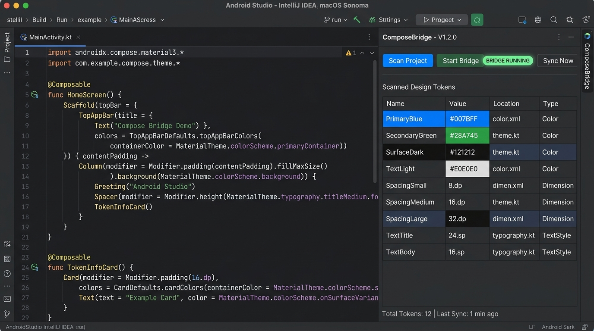
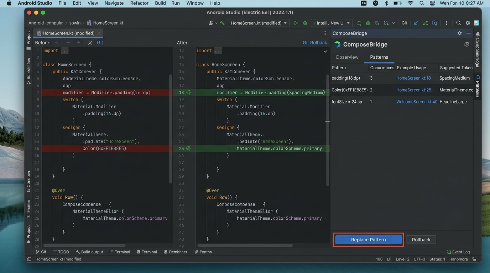
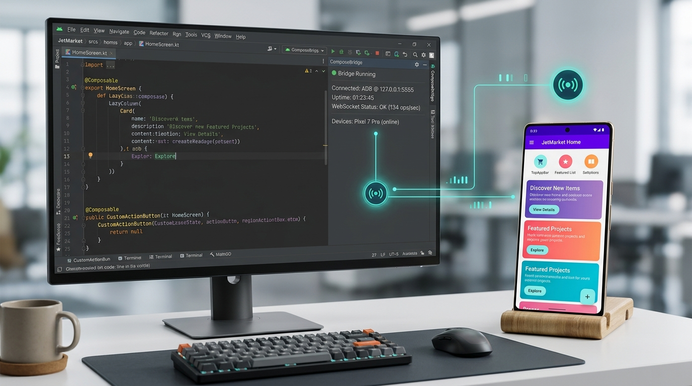

# ComposeBridge 🌉

> 📖 **إلى أين تتجه أداة ComposeBridge؟** اقرأ [وثيقة الرؤية والمعمارية RFC](docs/architecture/RFC-001-vision.md).

**محرر بصري حي على الجهاز الحقيقي لتطبيقات Jetpack Compose + خادم MCP لوكلاء الذكاء الاصطناعي. تعديل الواجهة لحظياً + تعديل جراحي في الكود المصدري.**

[](https://kotlinlang.org)
[](https://developer.android.com/jetpack/compose)
[]()
[]()
[-success.svg)]()
[]()
[]()
[](https://github.com/JALAL591/compose-bridge/blob/main/LICENSE)
[](https://plugins.jetbrains.com/plugin/35226-composebridge)
[](https://m8ven.ai/mcp/jalal591-compose-bridge-rapm1x?s=readme)

## 📰 Featured In

<p align="left">
  <a href="https://androidweekly.net/issues/issue-746" title="Android Weekly Issue #746">
    
  </a>
  &nbsp;
  <a href="https://jetc.dev/issues/336.html" title="jetc.dev Newsletter Issue #336">
    
  </a>
</p>

[English](https://github.com/JALAL591/compose-bridge/blob/main/README.md) | [العربية](https://github.com/JALAL591/compose-bridge/blob/main/README_AR.md)

---

### 📥 التحميل المباشر والتثبيت السريع (v1.1.8)

| الحزمة | ملف التثبيت (.zip / .aar) | طريقة التثبيت السريع |
|---|---|---|
| **إضافة بيئة التطوير (Android Studio / IntelliJ)** | [🚀 **تثبيت من متجر JetBrains Marketplace الرسمي**](https://plugins.jetbrains.com/plugin/35226-composebridge)<br>أو [📥 **تحميل ComposeBridgeIntelliJ-1.1.8.zip**](https://github.com/JALAL591/compose-bridge/raw/main/dist/ComposeBridgeIntelliJ-1.1.8.zip) | التثبيت بضغطة زر من المتجر مباشرة، أو في Android Studio: `Settings` ➔ `Plugins` ➔ `⚙️` ➔ `Install Plugin from Disk...` |
| **مكتبة أندرويد لـ Jetpack Compose (Agent)** | [📦 **تحميل composebridge-agent-release.aar**](https://github.com/JALAL591/compose-bridge/raw/main/dist/composebridge-agent-release.aar) | انسخ الملف إلى مجلد `app/libs/` أو ضعه في `debugImplementation` |
| **مكتبة أندرويد الأساسية (Runtime)** | [📦 **تحميل composebridge-runtime-release.aar**](https://github.com/JALAL591/compose-bridge/raw/main/dist/composebridge-runtime-release.aar) | ضعه في `implementation` لضمان أمان البناء في وضعي Debug و Release |
| **سيرفر بايثون وخادم MCP** | [📦 **تحميل composebridge-server-1.1.8.zip**](https://github.com/JALAL591/compose-bridge/raw/main/dist/composebridge-server-1.1.8.zip) | حزمة السيرفر المنفصلة لوكلاء الذكاء الاصطناعي والمزامنة |
| **الحزمة الشاملة المتكاملة (All-in-One)** | [📦 **تحميل ComposeBridge-v1.1.8-AllInOne.zip**](https://github.com/JALAL591/compose-bridge/raw/main/dist/ComposeBridge-v1.1.8-AllInOne.zip) | تجمع الإضافة، العميل، مكتبة الـ Runtime، التوثيق، والسيرفر معاً |

**ComposeBridge** هي حزمة أدوات للمطورين تربط تطبيق Compose (KMP/Android) بمحرر الأكواد أو وكيل الذكاء الاصطناعي الخاص بك.

> [!NOTE]
> **حالة دعم KMP / Desktop**: دعم KMP/Desktop حالياً في مرحلة **Beta تجريبية**. التركيز الأساسي لإصدار v1.1.6 ينصب على **استقرار منصة أندرويد (Android stability)**.


### 🎯 ما الجديد في الإصدار v1.0.0؟
- **وضع التركيز (Focus Mode):** الآن، تعرض النافذة السفلية **فقط** ألوان وأبعاد العنصر الذي تم لمسه. لا مزيد من البحث في القوائم الطويلة.
- **تعديل الكل أو الفصل (Global vs. Split):** قم بتغيير قيمة في المشروع بأكمله، أو أنشئ "توكن" معزول لهذا العنصر فقط.
- **طابور التعديلات المعلقة (Queue):** اجمع عدة تعديلات للواجهة محلياً ثم اضغط **Sync** مرة واحدة.
- **دعم الأبعاد (Dimensions):** عدّل الارتفاع، العرض، الحشوات، وأحجام الخطوط لحظياً — وليس الألوان فقط.
- **المراجعة والتراجع (Review & Reject):** مراجعة كاملة تشبه `git status` داخل بيئة التطوير. اعتمد التغييرات (Approve) أو تراجع عنها بالبايت (Reject All).
- **34 أداة MCP متكاملة:** يمكن لوكلاء الذكاء الاصطناعي الآن تشغيل بناء Gradle، واكتشاف الأنماط، والتراجع عن التغييرات بشكل مستقل.

### 🎬 شاهد المشروع أثناء العمل ولقطات الشاشة

اضغط على المعاينة لمشاهدة الفيديو التجريبي على YouTube وتعديل الواجهة لحظياً:

<p align="center">
  <a href="https://youtu.be/Hywyq7cBdDM">
    
  </a>
</p>

#### 📸 لقطات الشاشة وتكامل بيئة التطوير مع الهاتف

| 1. لوحة تحكم الإضافة وفاحص التوكنز | 2. التعديل الجراحي ومراجعة الفروقات (Diff) | 3. المعاينة المباشرة على شاشة الهاتف |
|:---:|:---:|:---:|
| <a href="https://github.com/JALAL591/compose-bridge/blob/main/docs/screenshots/1_composebridge_main_ui.jpg"></a> | <a href="https://github.com/JALAL591/compose-bridge/blob/main/docs/screenshots/2_composebridge_patterns_diff.jpg"></a> | <a href="https://github.com/JALAL591/compose-bridge/blob/main/docs/screenshots/3_composebridge_live_device_sync.jpg"></a> |

---

## 🚀 المميزات الرئيسية

| الميزة | الوصف |
|--------|-------|
| **⚡ معاينة حية** | عدّل الألوان والأبعاد بـ **زمن استجابة أقل من 50 مللي ثانية**. تنعكس التغييرات فوراً على الهاتف (بعد إعادة بناء أولية واحدة). |
| **🎯 وضع التركيز** | تعرض النافذة السفلية **فقط** خصائص العنصر المحدد (مثل `c1`، `c2`، `padding`). |
| **🧠 ذكاء دلالي** | يكتشف ما إذا كانت القيمة مشتركة. يوفر خيار **الفصل (Split)** (عزلها لهذه البطاقة) أو **الكل (Global)** (تغييرها في كل مكان). |
| **💾 إعادة هيكلة آمنة** | تعديل جراحي مدعوم بـ AST. يتم تتبع التغييرات في `PatternJournal`. **التراجع (Reject All)** يعيد الملفات بايت ببايت. |
| **🔌 إضافة بيئة التطوير** | 5 تبويبات: Scan، Impact، Split، Patterns، و **Changes** (واجهة اعتماد/رفض). |
| **🤖 خادم MCP مستقل** | يعمل بدون الحاجة إلى الهاتف. يمكن لوكلاء الذكاء الاصطناعي فحص المشروع، وإعادة هيكلته، وبنائه. |

---

## ⚙️ كيف تعمل الأداة خلف الكواليس (Under the Hood)

تعمل ComposeBridge كمنظومة ثلاثية الأطراف تنسق بين إضافة الـ IDE، ومحرك التعديل الجراحي، والمراقب الحي على الهاتف:

- **إضافة بيئة التطوير (Android Studio / IntelliJ Plugin):**
  تدير عمليات خادم البايثون في الخلفية، وتعرض حالة الاتصال والنبضات اللحظية، وتنشئ رموز QR لشبكة Tailscale WireGuard الآمنة للاتصال عن بُعد، وتوفر تبويبات الفحص (`Changes`, `Tokens`, `Orphans`, `Patterns`, `Status`) مع واجهة لمراجعة الفروقات واعتمادها أو رفضها.
- **سيرفر بايثون ومحرك الـ AST الجراحي (Tree-sitter):**
  خادم WebSocket سريع يعمل على المنفذ `8711`. عند استقبال أي تعديل، يقوم Tree-sitter بتحليل شجرة قواعد كود Kotlin وتعديل السطر المطلوب جراحياً دون إعادة تنسيق الكود أو المساس بالتعليقات، مع نظام قفل ذري للملفات (`_atomic_write_text`) وحفظ دقيق لنهايات الأسطر (CRLF/LF).
- **عميل أندرويد (:composebridge-agent):**
  يعمل كطبقة خفيفة فوق واجهة التطبيق عبر `ComposeBridgeAgent.Root`. يلتقط لمسات المستخدم في وضع التصميم، ويحسب أبعاد وإحداثيات العناصر عبر `CompositionRegistry`، ويطبق التعديلات محلياً وفورياً (<50ms) عبر سجلات `BridgeThemeRegistry` و `BridgeDimensionRegistry` و `BridgeTextRegistry`.
- **محرك اليومية والتراجع الآمن (PatternJournal):**
  قبل تعديل أي ملف، يتم فحص صحة قواعده بـ Tree-sitter وأخذ نسخة احتياطية سالمة `.bridge.bak`. عند التراجع (Reject)، تعتمد الأداة على Git أولاً (`git checkout -- <file>`) لضمان استرجاع سليم 100%، وتعود للنسخة الاحتياطية في الملفات غير المتتبعة.
- **بروتوكول سياق النموذج (MCP Server):**
  يوفر 34 أداة قياسية عبر stdio/JSON-RPC تمكّن وكلاء الذكاء الاصطناعي (مثل Antigravity, Cursor, Claude) من فحص المشروع والتوكنات والقيام بإعادة الهيكلة آلياً دون الحاجة لاتصال هاتف حقيقي.

---

## 📦 هيكل المستودع

```text
composebridge/
├── agent/       # مكتبة Android للـ runtime (:composebridge-agent)
├── server/      # خادم WebSocket + خادم MCP + مُعدّل الكود الجراحي
├── plugin/      # إضافة Android Studio (5 تبويبات)
└── docs/        # التوثيق المعماري وأدلة الإعداد
```

---

## 🔄 دليل الترقية من v1.1.x إلى v1.1.8

الترقية إلى الإصدار v1.1.8 سهلة ومباشرة ولا تتضمن **أي تغييرات كاسرة (Zero Breaking Changes)** في كود مشروعك أو إعدادات Gradle:

1. **تحديث إضافة بيئة التطوير (IDE Plugin):** قم بتثبيت حزمة الإضافة المحدثة `dist/ComposeBridgeIntelliJ-1.1.8.zip` في Android Studio عبر (**Settings** ➔ **Plugins** ➔ **Install Plugin from Disk...**) وأعد تشغيل البرنامج.
2. **تحديث مكتبة الـ Android AAR:** استبدل ملف `composebridge-agent-release.aar` في مجلد `libs/` داخل تطبيقك بالنسخة المحدثة من `dist/composebridge-agent-release.aar`، ثم أعد مزامنة Gradle (`Sync Project`).
3. **تحديث سيرفر البايثون:** إذا كنت تشغله يدوياً، حدّث الحزم عبر `pip install -r requirements.txt --upgrade` في مجلد `server/`.
4. **التغييرات الكاسرة:** **لا توجد أي تغييرات كاسرة.** جميع بروتوكولات الاتصال وسجلات الـ Runtime وأدوات الـ MCP متوافقة 100% مع الإصدارات السابقة.

---

## 🛠️ التشغيل السريع (Android / KMP)

يمكنك تشغيل ComposeBridge والاتصال به بطريقتين حسب بيئة عملك:

### 🔹 الخيار الأول: استخدام إضافة Android Studio Plugin (موصى به للمطورين)

لا حاجة لفتح الـ Terminal أو تشغيل أوامر يدوياً؛ تتكفل إضافة بيئة التطوير بإدارة الخادم وتوجيه المنافذ تلقائياً بنقرة زر واحدة.

1. **افتح نافذة الأدوات (ToolWindow)**: في Android Studio، افتح نافذة **ComposeBridge** من الشريط الجانبي الأيمن.
2. **شغّل السيرفر**: اضغط على زر **▶ Start Bridge**.
   - تقوم الإضافة بتشغيل `server.py` في الخلفية وتطبيق أمر `adb reverse tcp:8711 tcp:8711` تلقائياً.
   - تتغير الحالة مباشرة إلى `🟢 Bridge Running`.
   - *(اختياري)* يمكنك تفعيل **Auto-start Bridge Server** من **Settings → ComposeBridge** لتشغيل السيرفر تلقائياً بمجرد فتح المشروع.
3. **أضف الـ Agent** إلى مشروعك وقم بتهيئته (انظر الخطوات بالأسفل).

---

### 🔹 الخيار الثاني: التشغيل المستقل / وكلاء الذكاء الاصطناعي (Standalone MCP)

هذا الخيار مخصص لمساعدي البرمجة بالذكاء الاصطناعي (Claude Desktop، Cursor، Antigravity IDE، Cline) أو في حال أردت تشغيل الخادم يدوياً عبر الطرفية:

1. **تشغيل الخادم المحلي يدوياً**:
   ```bash
   cd server
   pip install -r requirements.txt
   python server.py
   ```
2. **توجيه المنفذ للهاتف عبر ADB**:
   ```bash
   adb reverse tcp:8711 tcp:8711
   ```
*(ملاحظة: إذا كنت تستخدم وكلاء الذكاء الاصطناعي عبر بروتوكول MCP فقط، فلا تحتاج لهاتف أو لأمر adb reverse؛ راجع قسم [خادم MCP](#-خادم-mcp-لوكلاء-الذكاء-الاصطناعي) أدناه).*

### 🌍 الاتصال عن بُعد (ميزة تجريبية - Experimental)

يمكنك ضبط وتعديل واجهات Jetpack Compose عبر الإنترنت (بيانات الهاتف، شبكات Wi-Fi مختلفة، أو أثناء العمل عن بُعد) دون الحاجة لكابل USB باستخدام **Tailscale Funnel**:

#### المتطلبات الأساسية:
- تثبيت تطبيق [Tailscale](https://tailscale.com/download) على جهاز الكمبيوتر والهاتف الذكي.
- إنشاء حساب Tailscale (مجاني تماماً للاستخدام الشخصي).

#### خطوات التشغيل بالتفصيل:

##### الخطوة 1: إعداد سياسات Tailscale (ACL) - خطوة حاسمة!
بشكل افتراضي، لا تسمح خدمة Tailscale بتشغيل خاصية Funnel ما لم يتم تفعيلها صراحة في سياسات التحكم بالوصول (Access Controls). قبل تشغيل أمر الـ Funnel:
1. اذهب إلى لوحة تحكم [Tailscale Admin Console - Access Controls](https://login.tailscale.com/admin/acls).
2. في محرر سياسات الـ JSON، أضف الكود التالي داخل القوسين الرئيسيين `{ ... }`:
   ```json
   "nodeAttrs": [
     {
       "target": ["*"],
       "attr": ["funnel"]
     }
   ]
   ```
3. اضغط على **Save** لحفظ التغييرات.
> [!IMPORTANT]
> **تحذير هام:** بدون هذه الخطوة، لن يعمل أمر `tailscale funnel 8711` وستظهر رسالة خطأ تفيد بعدم السماح: `funnel not allowed by ACLs`.

##### الخطوة 2: تشغيل Tailscale Funnel على جهاز الكمبيوتر
1. افتح تطبيق Tailscale وسجّل الدخول.
2. في موجه الأوامر (Terminal / PowerShell)، شغّل الأمر التالي:
   ```bash
   tailscale funnel 8711
   ```
   *(أو: `tailscale serve https / http://127.0.0.1:8711`)*
3. **اترك هذه النافذة مفتوحة** (يجب أن يظل نفق Tailscale Funnel قيد التشغيل).

##### الخطوة 3: الحصول على الرابط في إضافة Android Studio / IntelliJ
1. افتح نافذة أداة **ComposeBridge** في الشريط الجانبي.
2. اضغط على زر **"Share Remote"**.
3. ستظهر لك نافذة منبثقة تحتوي على **QR Code** ورابط الاتصال المشفر المباشر (`wss://...`).

##### الخطوة 4: الاتصال عبر الهاتف الذكي
1. افتح تطبيقك (المدمج به ComposeBridge Agent).
2. اضغط على أيقونة وضع التصميم العائمة 🎨 ثم افتح **إعدادات الاتصال (Connection Settings)**.
3. اختر تبويب **"Remote"**:
   - اضغط على **"Scan QR"** وامسح الرمز مباشرة من شاشة الكمبيوتر، **أو**
   - الصق الرابط يدوياً عبر زر **"Paste from Clipboard"**.
4. اضغط على **"Connect Remote"** لبدء المزامنة الحية فوراً.

> [!WARNING]
> **تنبيه صادق وشفاف:** ميزة الاتصال عن بُعد هي **ميزة تجريبية (Experimental)**. قد ينقطع الاتصال نتيجة لتغييرات الشبكة (مثل التبديل بين Wi-Fi وبيانات الهاتف)، أو جدران الحماية الصارمة، أو دخول الهاتف في وضع توفير الطاقة والنوم (Phone Sleep). للحصول على أعلى استقرار وزمن استجابة فائق (<50ms)، يُوصى دائماً باستخدام **اتصال USB المباشر**. لمزيد من التفاصيل راجع [LIMITATIONS.md](LIMITATIONS.md).

---

### 📲 خطوات دمج الـ Agent في تطبيقك

#### 1. أضف المكتبات إلى مشروعك (عزل بيئة الإنتاج)
انسخ مكتبي `composebridge-runtime-release.aar` و `composebridge-agent-release.aar` إلى مجلد `libs/` في تطبيقك:
```kotlin
// app/build.gradle.kts
dependencies {
    // 1. مكتبة Runtime الأساسية: تُترجم بأمان في نسختي Debug و Release
    implementation(files("libs/composebridge-runtime-release.aar"))

    // 2. مكتبة الـ Agent وأدوات التعديل التفاعلية: تُضاف في وضع Debug فقط
    debugImplementation(files("libs/composebridge-agent-release.aar"))
}
```

##### ⚠️ مشاريع Kotlin Multiplatform (KMP)
إذا كان مشروعك يستهدف كلاً من Android و Desktop (KMP) وكنت تستخدم سجلات ComposeBridge داخل `commonMain`، **لا تستخدم ملفات الـ `.aar`** (حيث إن مترجم الكمبيوتر Desktop لا يستطيع قراءة حزم `.aar` الخاصة بنظام Android). بدلاً من ذلك، استخدم الموديولات المصدرية كالتالي:

1. انسخ مجلد `agent/runtime` إلى مشروعك (مثال: `composebridge-agent/runtime`).
2. في ملف `settings.gradle.kts` (أو `settings.gradle`)، أضف موديول الـ runtime:
   ```kotlin
   include(":composebridge-runtime")
   project(":composebridge-runtime").projectDir = file("composebridge-agent/runtime")
   ```
3. في ملف `composebridge-agent/build.gradle.kts`، صدّر الـ runtime كتابعية `api`:
   ```kotlin
   kotlin {
       sourceSets {
           commonMain.dependencies {
               api(project(":composebridge-runtime"))
           }
       }
   }
   ```
4. في ملف `composeApp/build.gradle.kts`، اربط الـ agent في `commonMain`:
   ```kotlin
   kotlin {
       sourceSets {
           commonMain.dependencies {
               implementation(project(":composebridge-agent"))
           }
       }
   }
   ```

#### 2. قم بتهيئته في MainActivity
```kotlin
override fun onCreate(savedInstanceState: Bundle?) {
    super.onCreate(savedInstanceState)
    ComposeBridgeAgent.start(context = this, serverUrl = "ws://127.0.0.1:8711")
    setContent {
        ComposeBridgeAgent.Root {
            App()
        }
    }
}
```

#### 3. الاتصال والتعديل
1. ثبّت التطبيق وشغّله على جهاز Android (أو المحاكي).
2. اضغط على **الزر العائم 🔧** → وضع التصميم مفعل.
3. المس أي عنصر Composable → يفتح وضع التركيز.
4. عدّل الألوان/الأبعاد مباشرة → اضغط **Sync**.

> **ملاحظة حول المعاينة الحية:** تغيير قيمة ثابتة أو تطبيق "توكن" جديد يتطلب **إعادة بناء واحدة** لتحديث الكود المترجم. بعد ذلك، ستكون جميع التعديلات المستقبلية عبر الـ Registry فورية.

---

## 🤖 AI Agent Integration (MCP) - تكامل وكلاء الذكاء الاصطناعي

يعرض ComposeBridge أدواته الـ 34 لوكلاء الذكاء الاصطناعي عبر بروتوكول Model Context Protocol (MCP). **لا يُشترط وجود هاتف لاستخدام MCP.**

> 💡 **كفاءة استهلاك السياق (Context Window):**
> "ComposeBridge uses Lazy Loading, so 34 MCP tools consume only ~176 tokens (<1% of context window)."

### العملاء المدعومون
- ✅ **Google Antigravity IDE**
- ✅ **Cursor**
- ✅ **Claude Desktop**
- ✅ **Cline / Continue**

### خطوات الإعداد والتكامل:

#### الخطوة 1: تشغيل سيرفر MCP
تأكد من تثبيت مكتبات السيرفر من مجلد `server`:
```bash
cd server
pip install -r requirements.txt
```

#### الخطوة 2: إعداد ملف `mcp_config.json`
أضف الإعداد التالي في ملف `mcp_config.json` داخل مجلد `.gemini/config/` أو مجلد إعدادات IDE / العميل الخاص بك:
```json
{
  "mcpServers": {
    "composebridge": {
      "command": "python",
      "args": ["-u", "/path/to/compose-bridge/server/mcp_server.py"],
      "env": {
        "COMPOSEBRIDGE_ROOT": "/مسار/مشروع/الاندرويد/الخاص/بك",
        "PYTHONIOENCODING": "utf-8"
      }
    }
  }
}
```

> ⚠️ **ملاحظة هامة جداً:** أي تعديل على `mcp_config.json` يتطلب بدء محادثة جديدة (**New Chat**) في الوكيل حتى يتم تحميل الأدوات الـ 34 تلقائياً.

#### خطوات الإعداد داخل Android Studio / Antigravity (UI Steps):
1. افتح Android Studio / IntelliJ IDEA.
2. اذهب إلى **Settings** (أو Preferences في الماك) → **Tools** → **AI** → **MCP Servers**.
3. اضغط على تبويب **Installed**.
4. اضغط على زر **"Import JSON file"** (أو **"...Add via JSON"** حسب إصدار الـ IDE).
5. الصق كود الـ JSON المرفق أعلاه.
6. اضغط **OK** أو **Apply**.
7. ⚠️ **هام جداً:** ابدأ **محادثة جديدة (New Chat)** أو أعد تشغيل الوكيل لكي يتم تحميل الأدوات الـ 34 الجديدة وتصبح مرئية.

### الأدوات المتاحة (34 أداة MCP)

| الفئة | الأدوات |
|-------|---------|
| **الاستكشاف والتحليل** | `list_tokens`, `find_token_by_color`, `get_token_impact`, `get_token_siblings`, `get_all_token_groups`, `list_orphans`, `get_naming_convention` |
| **التعديل الجراحي** | `set_token`, `set_text`, `add_token`, `rollback_last` |
| **إعادة الهيكلة والأنماط** | `detect_conditional_variants`, `replace_pattern`, `list_applied_patterns`, `rollback_pattern`, `suggest_token_split` |
| **إدارة التغييرات** | `list_modified_files`, `get_file_diff`, `approve_file_changes`, `reject_file_changes`, `approve_all_files`, `reject_all_files`, `reject_all_files_force` |
| **البناء والمزامنة** | `run_gradle_build`, `list_allowed_gradle_tasks`, `trigger_user_sync`, `get_sync_status` |

---

## ⚠️ دعم المنصات (الإصدار v1.1.6)

| الميزة | Android | Desktop | iOS |
|--------|:-------:|:-------:|:---:|
| **خادم MCP (الذكاء الاصطناعي)** | ✅ | ✅ | ✅ |
| **إضافة بيئة التطوير** | ✅ | ✅ | ✅ |
| **التعديل الحي على الهاتف** | ✅ | ❌ | ❌ |

*التعديل الحي على سطح المكتب (Desktop) و iOS في مرحلة التطوير النشط.*

---

## 🔎 عبارات البحث التي يحلها هذا المشروع
- تعديل Jetpack Compose بدون إعادة تجميع
- بديل Hot Reload لـ Compose
- فاحص تخطيط تفاعلي لـ Android
- تعديل واجهة حي على جهاز Android حقيقي
- مزامنة design tokens إلى كود Kotlin
- توليد واجهة Compose من JSON

---

## ⚠️ القيود الصادقة والحدود التشغيلية (Honest Limitations)

> 📖 **الإفصاح الفني الشامل:** للاطلاع على كامل الحدود التشغيلية والمعمارية بدقة وشفافية، راجع **[LIMITATIONS.md](LIMITATIONS.md)**.
> 
> ⚠️ **تنبيه صادق:** **الاتصال عن بُعد ميزة تجريبية (Remote Connection is experimental).** كما أن الأداة **تتوقف بأمان تام** (`NEEDS_MANUAL_MAPPING`) وترفض التعديل العشوائي إذا لم تجد ملفات التصميم (الألوان، الأبعاد، النصوص) حتى تقوم بتحديدها في تبويب **Discovery** لحماية مشروعك من التلوث البرمجي.

- **استقرار الاتصال عن بُعد:** ميزة الاتصال عبر الإنترنت تجريبية. اتصالات USB المباشرة هي الخيار الموصى به للاستقرار التام.
- **إلزامية مسار التصميم عند الغياب:** لن تكتب الأداة في أي ملف عشوائي إذا غابت ملفات الأنماط المركزية.

---

## 📜 الترخيص
موزّع تحت رخصة [Apache License 2.0](https://github.com/JALAL591/compose-bridge/blob/main/LICENSE).

---

## 🌍 الاتصال والتحكم عن بُعد عبر Tailscale (Remote Access)

يقدم ComposeBridge v1.1.6 ميزة الاتصال عن بُعد الآمن باستخدام تقنية **Tailscale Funnel** المبنية على بروتوكول WireGuard والتشفير الكامل. يمكنك الآن معاينة وتعديل واجهات Compose مباشرة على الهواتف الحقيقية عبر شبكات الإنترنت الخارجية وبيانات الهاتف دون الحاجة لكابل USB.

### 1. المتطلبات الأساسية
- قم بتثبيت **Tailscale** على حاسوب التطوير: [https://tailscale.com/download](https://tailscale.com/download)
- سجل الدخول وشغل الخدمة: `tailscale up`
- تأكد من تفعيل خاصية [Tailscale Funnel](https://tailscale.com/kb/1223/funnel) لحسابك.

### 2. تفعيل المشاركة من بيئة التطوير (Android Studio Plugin)
1. افتح نافذة **ComposeBridge** في أندرويد ستوديو.
2. انقر على **▶ Start Bridge** لتشغيل السيرفر المحلي مع التوكن الديناميكي العشوائي.
3. انقر على زر **🌍 Share Remote** في شريط الأدوات:
   - ستقوم الإضافة بتشغيل نفق `tailscale funnel 8711 --bg` تلقائياً.
   - ستظهر نافذة منبثقة تحتوي على رمز **QR Code** يضم رابط الاتصال الآمن `wss://<node>.<tailnet>.ts.net` وتوكن المصادقة الديناميكي.
4. يمكنك نسخ الرابط أو التوكن بنقرة زر، أو إيقاف المشاركة بالنقر على **Stop Sharing**.

### 3. الاتصال من تطبيق الهاتف (ComposeBridge Agent)
1. افتح تطبيقك (في وضع Debug) المزود بـ `ComposeBridgeAgent`.
2. انقر على الزر العائم **🎨** لإظهار شريط الأدوات، ثم انقر على أيقونة **🌍**.
3. انقر على **📷 مسح QR أو لصق من الحافظة** (أو الصق JSON مباشرة).
4. سيتصل الوكيل فوراً بالسيرفر عبر بروتوكول مشفر `wss://` ويبدأ المزامنة الحية للتصميم.
5. للعودة للاتصال المحلي السلكي، اضغط على **محلي (127.0.0.1)** في أي وقت.
